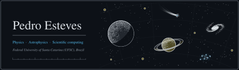
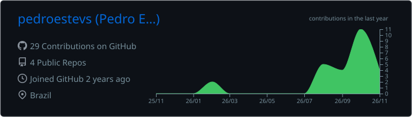

  

Physics undergraduate at the **Federal University of Santa Catarina (UFSC)**, Brazil.
I work with observational astronomy and astronomical data: photometry, time series and catalogues.

## About

My main interests are stellar astrophysics and exoplanets, in particular the use of photometric, astrometric and time-series data to study stellar systems and their circumstellar environments.

Programming is part of the research itself, from processing survey catalogues to building reproducible analysis pipelines and the software around them.

## Research

<table>
  <tr>
    <td width="50%" valign="top">
      <strong>Astrophysics</strong>  
      Stellar astrophysics 
      Exoplanets 
      Stellar variability 
      Binary and multiple systems 
      Circumstellar environments
    </td>
    <td width="50%" valign="top">
      <strong>Data and computation</strong>  
      Astronomical surveys 
      Photometric and time-series analysis 
      Catalogue processing and cross-matching 
      Scientific computing 
      Data visualization
    </td>
  </tr>
</table>

**Data I work with:** `Gaia` · `VVV / VVVX` · `VIRAC2` · `TESS` · `Spitzer / GLIMPSE` · `DECaPS`

## Selected work

| Project | What it is |
| --- | --- |
| [**nuvem-n-corpos**](https://github.com/pedroestevs/nuvem-n-corpos) | Direct N-body simulation of a rotating, self-gravitating cloud that collapses into a disk. Tested, MIT-licensed. |
| [**hw-vir-fotometria**](https://github.com/pedroestevs/hw-vir-fotometria) | Differential photometry of the eclipsing binary HW Virginis, observed in V at the 0.6 m telescope of OPD/LNA. |

## Programming

Most of what I build is Python, from survey-scale catalogue pipelines to production web back ends, with TypeScript on the front end.

  

<table>
  <tr>
    <td width="50%" valign="top">
      <strong>Research pipelines</strong>  
      Cross-matching and filtering multi-survey catalogues (Gaia, VVV/VIRAC2, GLIMPSE) with Polars, Dask and PyArrow; SED fitting and infrared-excess selection; light-curve and periodicity analysis; Bayesian inference with emcee and dynesty; eclipsing-binary modelling with PHOEBE; publication figures with a custom Matplotlib style.
    </td>
    <td width="50%" valign="top">
      <strong>Software</strong>  
      A full-stack web platform: FastAPI, SQLAlchemy/Alembic and PostgreSQL behind a Next.js/TypeScript front end, containerised with Docker Compose and tested with pytest and Playwright end-to-end.  
      A Windows desktop automation app (pywebview, Selenium) packaged with PyInstaller.
    </td>
  </tr>
  <tr>
    <td width="50%" valign="top">
      <strong>Science communication</strong>  
      An interactive planetarium presentation in React, Vite, D3 and GSAP, and a research video rendered in code with Remotion.
    </td>
    <td width="50%" valign="top">
      <strong>How I work</strong>  
      Reproducible environments (conda, WSL, pinned requirements), tests before results, version control for everything, and papers and posters in LaTeX.
    </td>
  </tr>
</table>

## GitHub activity

  

## Contact

[LinkedIn](https://www.linkedin.com/in/pedro-esteves-14539b234/) · [Email](mailto:estevesp8@gmail.com)

Header drawn procedurally in Python (pen-and-ink style); source in <a href="./assets/header.py"><code>assets/header.py</code></a>.
